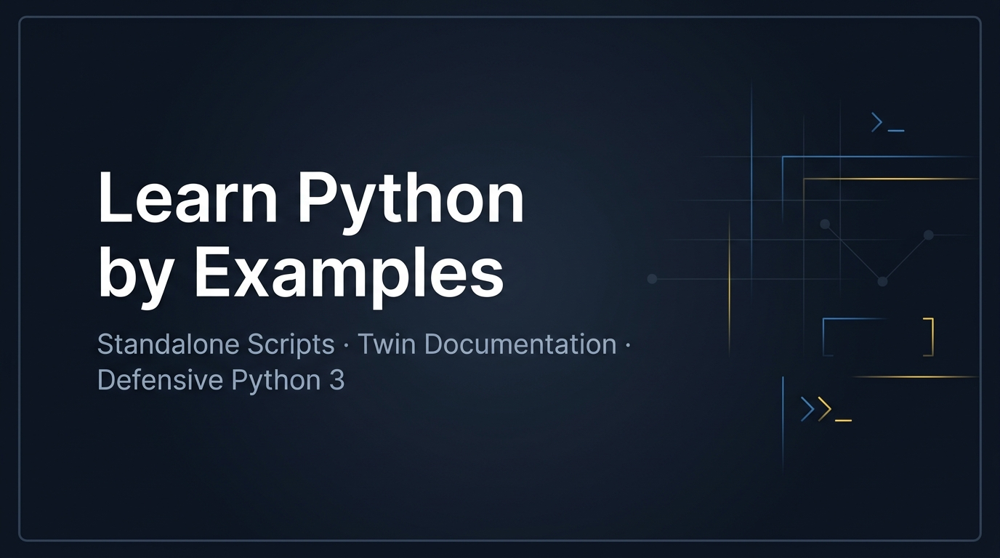
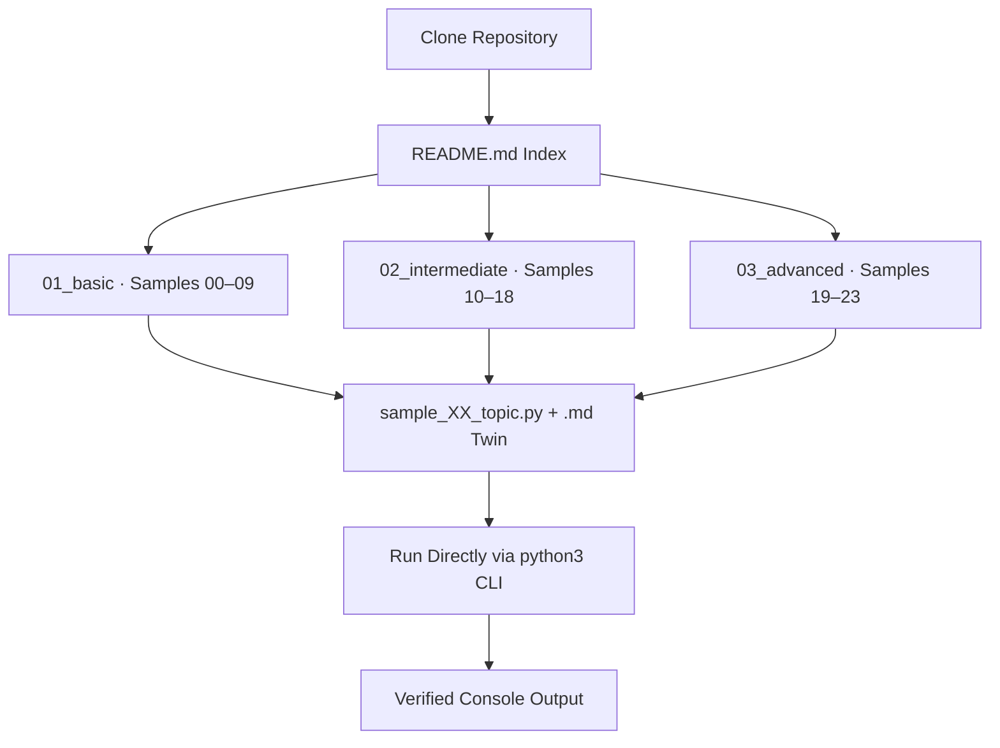

<div align="center">



# Learn Python by Examples

**A progressive, hands-on Python curriculum built with standalone scripts, synchronized twin documentation, and defensive engineering patterns.**

Designed for learners and developers who want clean, idiomatic Python 3 code—moving step by step from core syntax to algorithmic problem solving and static type safety.

<p>
  <a href="#overview">Overview</a> ·
  <a href="#quick-start">Quick Start</a> ·
  <a href="#capabilities">Capabilities</a> ·
  <a href="#examples">Examples</a> ·
  <a href="#architecture">Architecture</a> ·
  <a href="#installation">Installation</a> ·
  <a href="#author">Author</a>
</p>

[](#installation)
[](#examples)
[](#documentation)
[](#license)
[](https://github.com/seyerjo/learn-python-by-examples/commits/main)

</div>

---

## Overview

Most beginner Python tutorials either show disconnected one-liners without error handling or hide fundamentals behind heavy third-party frameworks. **Learn Python by Examples** takes an engineering-first approach:

* **Zero-framework focus:** Every script relies purely on Python's standard library so learners master the language itself before introducing external dependencies.
* **1:1 Twin Documentation:** Every `.py` file is paired with an exact `.md` companion explaining the concept, step-by-step execution flow, common pitfalls, and expected terminal output.
* **Production habits from day one:** Examples enforce PEP 8 formatting, modular `main()` entry guards, PEP 484 type hints, Google-style docstrings, and defensive `try-except` validation.

## Quick Start

Clone the repository and execute any script directly from the terminal:

```bash
python3 code/03_advanced/sample_23_type_hinting.py
```

**Expected Output:**

```text
--- Demonstrating Basic Type Hinting ---
The result of add_numbers(10, 5) is: 15
The value of PI (hinted as float) is: 3.14159

--- Demonstrating Complex Type Hinting ---
Counting words in: ['hello world', 'hello python']
Resulting dictionary: {'hello': 2, 'world': 1, 'python': 1}
```

## Capabilities

* **Graduated Difficulty Curve:** Structured progression across three tiers—from primitive types and control flow (`01_basic`) to loops, recursion, and exceptions (`02_intermediate`), culminating in numerical algorithms and type safety (`03_advanced`).
* **Algorithmic Comparisons Side by Side:** Samples `19` through `21` solve the same root-finding problem with brute-force enumeration, step approximation, and binary search so learners can observe iteration counts and algorithmic complexity firsthand.
* **Defensive Input & Error Handling:** Dedicated patterns (`sample_18`, `sample_22`) demonstrate how to intercept `ValueError` and validate numeric bounds cleanly instead of crashing on malformed user input.
* **Self-Guided Reference Library:** Predictable `sample_XX_topic` naming allows quick lookup as a personal cheat sheet or structured study track (actively expanding from 24 toward 100+ examples).

## Examples

<details open>
<summary><strong>Basic Level</strong> — 10 examples (<code>code/01_basic</code>)</summary>

| # | Topic | Focus | Links |
| :-: | :--- | :--- | :---: |
| 00 | Comments & Types | Single-line, multi-line & inline comments | [Code](./code/01_basic/sample_00_comments_types.py) · [Docs](./code/01_basic/sample_00_comments_types.md) |
| 01 | Hello World | Entry point & `__main__` guard | [Code](./code/01_basic/sample_01_hello_world.py) · [Docs](./code/01_basic/sample_01_hello_world.md) |
| 02 | Primitive Data Types | `int`, `float`, `str`, `bool` & `type()` | [Code](./code/01_basic/sample_02_primitives_data_types.py) · [Docs](./code/01_basic/sample_02_primitives_data_types.md) |
| 03 | String Operations | Concatenation, repetition, indexing & slicing | [Code](./code/01_basic/sample_03_strings_operations.py) · [Docs](./code/01_basic/sample_03_strings_operations.md) |
| 04 | Operators | Arithmetic, comparison & logical operators | [Code](./code/01_basic/sample_04_operators.py) · [Docs](./code/01_basic/sample_04_operators.md) |
| 05 | Console Inputs | Reading input & type casting | [Code](./code/01_basic/sample_05_inputs.py) · [Docs](./code/01_basic/sample_05_inputs.md) |
| 06 | Fundamentals | Naming rules, keywords & dynamic typing | [Code](./code/01_basic/sample_06_fundamentals.py) · [Docs](./code/01_basic/sample_06_fundamentals.md) |
| 07 | Flow Control | Branching with `if`, `elif` & `else` | [Code](./code/01_basic/sample_07_flow_control.py) · [Docs](./code/01_basic/sample_07_flow_control.md) |
| 08 | More Fundamentals | Encapsulation, reuse & DRY principle | [Code](./code/01_basic/sample_08_more_fundamentals.py) · [Docs](./code/01_basic/sample_08_more_fundamentals.md) |
| 09 | Escape Characters & Strings | Escape sequences & raw strings (`r"..."`) | [Code](./code/01_basic/sample_09_escape_character_and_strings.py) · [Docs](./code/01_basic/sample_09_escape_character_and_strings.md) |

</details>

<details>
<summary><strong>Intermediate Level</strong> — 9 examples (<code>code/02_intermediate</code>)</summary>

| # | Topic | Focus | Links |
| :-: | :--- | :--- | :---: |
| 10 | While Iterations | Loops, conditions & counter updates | [Code](./code/02_intermediate/sample_10_while_iterations.py) · [Docs](./code/02_intermediate/sample_10_while_iterations.md) |
| 11 | More While Iterations | Nested loops & multi-variable state | [Code](./code/02_intermediate/sample_11_more_while_iterations.py) · [Docs](./code/02_intermediate/sample_11_more_while_iterations.md) |
| 12 | Additional While Iterations | Loop control & `break` termination | [Code](./code/02_intermediate/sample_12_additional_while_iterations.py) · [Docs](./code/02_intermediate/sample_12_additional_while_iterations.md) |
| 13 | For Iterations | Traversal with `for` & `range()` | [Code](./code/02_intermediate/sample_13_for_iterations.py) · [Docs](./code/02_intermediate/sample_13_for_iterations.md) |
| 14 | More For Iterations | Strings, collections & step ranges | [Code](./code/02_intermediate/sample_14_more_for_iterations.py) · [Docs](./code/02_intermediate/sample_14_more_for_iterations.md) |
| 15 | Functions | Modular signatures, parameters & returns | [Code](./code/02_intermediate/sample_15_functions.py) · [Docs](./code/02_intermediate/sample_15_functions.md) |
| 16 | Recursive Functions | Base cases & recursive factorials | [Code](./code/02_intermediate/sample_16_recursive_functions.py) · [Docs](./code/02_intermediate/sample_16_recursive_functions.md) |
| 17 | Recursion Limit | Stack protection & `sys.getrecursionlimit()` | [Code](./code/02_intermediate/sample_17_recursion_limit.py) · [Docs](./code/02_intermediate/sample_17_recursion_limit.md) |
| 18 | Exception Handling | `try-except-else-finally` & `ValueError` | [Code](./code/02_intermediate/sample_18_exception_handling.py) · [Docs](./code/02_intermediate/sample_18_exception_handling.md) |

</details>

<details>
<summary><strong>Advanced Level</strong> — 5 examples (<code>code/03_advanced</code>)</summary>

| # | Topic | Focus | Links |
| :-: | :--- | :--- | :---: |
| 19 | Exhaustive Listing Algorithm | Brute-force guess-and-check enumeration | [Code](./code/03_advanced/sample_19_exhaustive_listing_algorithm.py) · [Docs](./code/03_advanced/sample_19_exhaustive_listing_algorithm.md) |
| 20 | Solution Approximation Algorithm | Root approximation via step tolerance | [Code](./code/03_advanced/sample_20_solution_approximation_algorithm.py) · [Docs](./code/03_advanced/sample_20_solution_approximation_algorithm.md) |
| 21 | Binary Search Algorithm | Logarithmic search & iteration counters | [Code](./code/03_advanced/sample_21_binary_search_algorithm.py) · [Docs](./code/03_advanced/sample_21_binary_search_algorithm.md) |
| 22 | Robust Input Validation | Reusable bounds-checked validation loop | [Code](./code/03_advanced/sample_22_robust_input_validation.py) · [Docs](./code/03_advanced/sample_22_robust_input_validation.md) |
| 23 | Type Hinting | PEP 484 annotations & static checks | [Code](./code/03_advanced/sample_23_type_hinting.py) · [Docs](./code/03_advanced/sample_23_type_hinting.md) |

</details>

## Architecture



* **Core Stack:** Plain Python 3 (`3.7+`) and Markdown—deliberately avoiding Jupyter `.ipynb` JSON blobs so diffs stay clean and scripts run directly in any terminal.
* **Code Standards:** Strictly formatted to PEP 8 (`autopep8` / `Prettier`), documented with Google-style docstrings, and annotated with PEP 484 type hints on public functions.
* **Defensive Coding:** Specific exception types (`ValueError`, `ZeroDivisionError`, etc.) are caught explicitly without bare `except:` blocks, and interactive scripts validate bounds before computation.

<details>
<summary>Project Structure</summary>

```text
learn-python-by-examples/
├── .github/
│   └── assets/
│       └── banner.png
├── code/
│   ├── 01_basic/           # Samples 00–09 (.py + .md twins)
│   ├── 02_intermediate/    # Samples 10–18 (.py + .md twins)
│   └── 03_advanced/        # Samples 19–23 (.py + .md twins)
├── docs/
│   ├── 01_project_blueprint.md
│   ├── 02_engineering_guidelines.md
│   └── 03_project_log.md
├── CHANGELOG.md
├── LICENSE
└── README.md
```

</details>

## Installation

### Prerequisites

* **Python 3.7+** (`python3 --version` or `python --version`)
* **Git** (`git --version`)

### Setup

```bash
git clone https://github.com/seyerjo/learn-python-by-examples.git
cd learn-python-by-examples

# Execute any sample directly
python3 code/01_basic/sample_01_hello_world.py
```

## Documentation

* **[Changelog](./CHANGELOG.md):** Release history and version milestones (currently `v1.2.5`, with recent updates under `## [Unreleased]`).
* **[Project Blueprint](./docs/01_project_blueprint.md):** Vision, functional/non-functional requirements, and feature scope.
* **[Engineering Guidelines](./docs/02_engineering_guidelines.md):** Technical architecture, tech stack rationale, and Python style guide.
* **[Project Log](./docs/03_project_log.md):** Expansion roadmap (`sample_24` to `sample_65`) and development log.

## License

Licensed under the **MIT** License — see **[LICENSE](./LICENSE)** for details.

## Author

Created and maintained by **Jose Miguel Reyes** ([GitHub](https://github.com/seyerjo)).

Questions, feedback, or technical inquiries? Open an **[Issue](https://github.com/seyerjo/learn-python-by-examples/issues)**.
