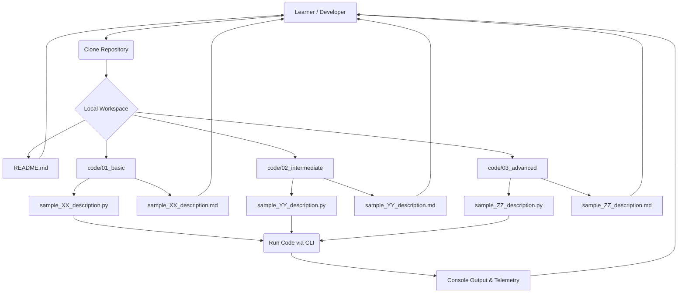

# 🚀 Learn Python by Examples
> A comprehensive, practical Python learning repository featuring self-contained code examples, synchronized twin documentation, and defensive programming patterns.


---

## 👋 Welcome!
Welcome to **Learn Python by Examples**! Whether you are taking your very first steps in Python or sharpening your skills in algorithms, input validation, and clean modular design, this repository offers standalone, ready-to-run scripts paired with clear explanations. Feedback, bug reports, new example proposals, and Pull Requests from the community are always warmly welcome!

---

## 🎯 Project Overview
* 👁️ **Vision:** To serve as an essential and practical guide for anyone learning Python, offering clean, structured, and progressively challenging code examples classified by difficulty.
* 📌 **Core Highlights:**
  * 🎯 **Growing Collection:** Roadmap toward 100+ Python code examples covering syntax fundamentals, data structures, control flow, algorithms, and design patterns.
  * 🎯 **Clear Tiered Structure:** Scripts organized into **Basic** (`code/01_basic`), **Intermediate** (`code/02_intermediate`), and **Advanced** (`code/03_advanced`).
  * 🎯 **Twin Documentation:** Dedicated companion Markdown guide for every single script (`sample_XX_description.md`).
  * 🎯 **Modern Engineering Standards:** Consistent adherence to PEP 8 style, Google-style docstrings, and PEP 484 type hinting.

---

## ⚡ Main Features
* 💎 **Modular Code Examples (`FEAT-01`):** Standalone, executable Python scripts illustrating specific programming concepts without heavyweight external dependencies (maps to `FR-01`, `FR-02`, `NFR-03`).
* 💎 **Synchronized Twin Documentation (`FEAT-02`):** Companion Markdown guides paired 1:1 with each script, explaining syntax mechanics, step-by-step logic, and expected terminal output (maps to `FR-03`, `FR-04`, `NFR-02`).
* 💎 **Tiered Repository Architecture (`FEAT-03`):** Predictable directory layout and standardized two-digit sequential naming (`sample_00` to `sample_23+`) for zero-friction navigation (maps to `FR-05`, `NFR-01`).
* 💎 **Defensive Error Handling (`FEAT-04`):** Practical demonstrations of input sanitization, specific exception interception (`try-except-else-finally`), and graceful error recovery (maps to `NFR-03`).

---

## 🛠️ Getting Started & Installation

### 📋 Prerequisites
* **Python 3.7+** installed on your system (`python3 --version` or `python --version`).
* **Git** installed on your system (`git --version`).

### ⚙️ Installation
```bash
# 1. Clone the repository
git clone https://github.com/seyerjo/learn-python-by-examples.git
cd learn-python-by-examples
```

---

## 🚀 Quick Usage
```bash
# Run a Basic example
python3 code/01_basic/sample_01_hello_world.py

# Run an Intermediate example
python3 code/02_intermediate/sample_18_exception_handling.py

# Run an Advanced example
python3 code/03_advanced/sample_21_binary_search_algorithm.py
```

---

## 🗺️ Workflow & Architecture



---

## 📝 Code Examples Directory

### 📗 Basic Level (`code/01_basic`)
| # | Topic & Description | Links |
| :---: | :--- | :---: |
| `00` | **Comments & Types** — Single-line, multi-line, and inline comment conventions. | [`.py`](./code/01_basic/sample_00_comments_types.py) · [`.md`](./code/01_basic/sample_00_comments_types.md) |
| `01` | **Hello World** — Standard entry point and `if __name__ == "__main__":` guard. | [`.py`](./code/01_basic/sample_01_hello_world.py) · [`.md`](./code/01_basic/sample_01_hello_world.md) |
| `02` | **Primitive Data Types** — Primitive types (`int`, `float`, `str`, `bool`) and `type()`. | [`.py`](./code/01_basic/sample_02_primitives_data_types.py) · [`.md`](./code/01_basic/sample_02_primitives_data_types.md) |
| `03` | **String Operations** — String concatenation, repetition, indexing, and slicing. | [`.py`](./code/01_basic/sample_03_strings_operations.py) · [`.md`](./code/01_basic/sample_03_strings_operations.md) |
| `04` | **Operators** — Arithmetic, comparison, and logical operators. | [`.py`](./code/01_basic/sample_04_operators.py) · [`.md`](./code/01_basic/sample_04_operators.md) |
| `05` | **Console Inputs** — Reading console input using `input()` and type casting. | [`.py`](./code/01_basic/sample_05_inputs.py) · [`.md`](./code/01_basic/sample_05_inputs.md) |
| `06` | **Fundamentals** — Variable naming rules, reserved keywords, and dynamic typing. | [`.py`](./code/01_basic/sample_06_fundamentals.py) · [`.md`](./code/01_basic/sample_06_fundamentals.md) |
| `07` | **Flow Control** — Conditional branching with `if`, `elif`, and `else`. | [`.py`](./code/01_basic/sample_07_flow_control.py) · [`.md`](./code/01_basic/sample_07_flow_control.md) |
| `08` | **More Fundamentals** — Code reusability, function encapsulation, and DRY principle. | [`.py`](./code/01_basic/sample_08_more_fundamentals.py) · [`.md`](./code/01_basic/sample_08_more_fundamentals.md) |
| `09` | **Escape Characters & Strings** — Escape sequences (`\n`, `\t`, `\\`) and raw string literals (`r"..."`). | [`.py`](./code/01_basic/sample_09_escape_character_and_strings.py) · [`.md`](./code/01_basic/sample_09_escape_character_and_strings.md) |

### 📙 Intermediate Level (`code/02_intermediate`)
| # | Topic & Description | Links |
| :---: | :--- | :---: |
| `10` | **While Iterations** — While loops, condition checks, and counter increments. | [`.py`](./code/02_intermediate/sample_10_while_iterations.py) · [`.md`](./code/02_intermediate/sample_10_while_iterations.md) |
| `11` | **More While Iterations** — Nested `while` loops and multi-variable state tracking. | [`.py`](./code/02_intermediate/sample_11_more_while_iterations.py) · [`.md`](./code/02_intermediate/sample_11_more_while_iterations.md) |
| `12` | **Additional While Iterations** — Loop control flow with `break` and conditional termination. | [`.py`](./code/02_intermediate/sample_12_additional_while_iterations.py) · [`.md`](./code/02_intermediate/sample_12_additional_while_iterations.md) |
| `13` | **For Iterations** — Sequence traversal with `for` loops and `range()`. | [`.py`](./code/02_intermediate/sample_13_for_iterations.py) · [`.md`](./code/02_intermediate/sample_13_for_iterations.md) |
| `14` | **More For Iterations** — Iterating over strings, collections, and step ranges. | [`.py`](./code/02_intermediate/sample_14_more_for_iterations.py) · [`.md`](./code/02_intermediate/sample_14_more_for_iterations.md) |
| `15` | **Functions** — Defining modular functions, parameters, and return values. | [`.py`](./code/02_intermediate/sample_15_functions.py) · [`.md`](./code/02_intermediate/sample_15_functions.md) |
| `16` | **Recursive Functions** — Base cases and recursive calls for factorials. | [`.py`](./code/02_intermediate/sample_16_recursive_functions.py) · [`.md`](./code/02_intermediate/sample_16_recursive_functions.md) |
| `17` | **Recursion Limit** — Stack overflow protection and `sys.getrecursionlimit()`. | [`.py`](./code/02_intermediate/sample_17_recursion_limit.py) · [`.md`](./code/02_intermediate/sample_17_recursion_limit.md) |
| `18` | **Exception Handling** — Defensive `try-except-else-finally` blocks and `ValueError` interception. | [`.py`](./code/02_intermediate/sample_18_exception_handling.py) · [`.md`](./code/02_intermediate/sample_18_exception_handling.md) |

### 📕 Advanced Level (`code/03_advanced`)
| # | Topic & Description | Links |
| :---: | :--- | :---: |
| `19` | **Exhaustive Listing Algorithm** — Brute-force exhaustive enumeration (guess-and-check). | [`.py`](./code/03_advanced/sample_19_exhaustive_listing_algorithm.py) · [`.md`](./code/03_advanced/sample_19_exhaustive_listing_algorithm.md) |
| `20` | **Solution Approximation Algorithm** — Numerical root approximation using incremental step tolerances. | [`.py`](./code/03_advanced/sample_20_solution_approximation_algorithm.py) · [`.md`](./code/03_advanced/sample_20_solution_approximation_algorithm.md) |
| `21` | **Binary Search Algorithm** — Logarithmic binary search for root finding with iteration counters. | [`.py`](./code/03_advanced/sample_21_binary_search_algorithm.py) · [`.md`](./code/03_advanced/sample_21_binary_search_algorithm.md) |
| `22` | **Robust Input Validation** — Reusable numeric validation loop with bounds checking. | [`.py`](./code/03_advanced/sample_22_robust_input_validation.py) · [`.md`](./code/03_advanced/sample_22_robust_input_validation.md) |
| `23` | **Type Hinting** — PEP 484 type annotations, function signatures, and static type safety. | [`.py`](./code/03_advanced/sample_23_type_hinting.py) · [`.md`](./code/03_advanced/sample_23_type_hinting.md) |

---

## 🤝 Contributing
Contributions, bug reports, and feature ideas are warmly welcome!
Please read our **[Contributing Guidelines](./CONTRIBUTING_GUIDELINES.md)** before opening an issue or submitting a Pull Request.

---

## ⚖️ Code of Conduct
We are committed to fostering an open, welcoming, and respectful community. All participants are expected to uphold our **[Code of Conduct](./CODE_OF_CONDUCT.md)**.

---

## 📄 License
This project is licensed under the **MIT** License — see the **[LICENSE](./LICENSE)** file for details.

---

## 📜 Changelog
Track project milestones and release notes in **[CHANGELOG.md](./CHANGELOG.md)** (currently at `v1.2.5`, with recent updates under `## [Unreleased]`).

---

## 📚 Project Documentation
* 📘 **[Project Blueprint](./docs/01_project_blueprint.md):** Vision, functional/non-functional requirements, and feature map.
* 🛠️ **[Engineering Guidelines](./docs/02_engineering_guidelines.md):** Technical architecture, tech stack, and code style guide.
* 📋 **[Project Log](./docs/03_project_log.md):** Active roadmap (`sample_24` to `sample_65`) and development log.
