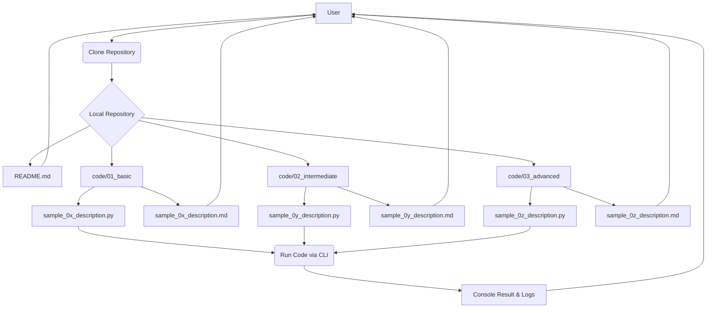

# Engineering Guidelines: Learn Python by Examples

## Technical Architecture

### 1. System Topology & Directory Structure
The repository is designed as a file-based educational system optimized for static exploration, local CLI execution, and version control. It follows a predictable modular layout:

```text
learn-python-by-examples/
├── .agents/                    # Agent rules, workflows, and prompts
│   ├── rules/                  # Active project rules (v2)
│   └── workflows/              # Structured operational workflows
├── code/                       # Main educational source code repository
│   ├── 01_basic/               # Beginner-level scripts and twin documentation
│   │   ├── sample_01_hello_world.py
│   │   └── sample_01_hello_world.md
│   ├── 02_intermediate/        # Intermediate-level scripts (control flow, functions, OOP)
│   └── 03_advanced/            # Advanced scripts (algorithms, optimization, generators)
├── docs/                       # Consolidated project documentation (3 core guides)
│   ├── 01_project_blueprint.md
│   ├── 02_engineering_guidelines.md
│   └── 03_project_log.md
├── .git/info/exclude           # Local exclusions for agent configs & private files
├── CHANGELOG.md                # Historical release log (Keep a Changelog standard)
├── LICENSE                     # Project license (MIT)
└── README.md                   # Primary project entry point & usage overview
```

### 2. Main Components Breakdown
- **Root Metadata (`/`):** Contains general repository configuration, public documentation (`README.md`, `LICENSE`), and release history (`CHANGELOG.md`).
- **Project Documentation (`/docs`):** The consolidated 3-file documentation core + root `CHANGELOG.md` maintaining project vision, architecture, and backlog.
- **Categorized Code Levels (`/code/01_basic`, `/code/02_intermediate`, `/code/03_advanced`):** Isolated folders grouping code examples by pedagogical complexity.
- **Twin File Standard:** Every script `sample_XX_description.py` has an exact twin `sample_XX_description.md` providing step-by-step technical breakdown, concepts illustrated, and sample execution output.

### 3. Conceptual Data Flow & User Navigation
Interaction is purely local and file-based. The diagram below illustrates how users clone, navigate, read documentation, and execute sample code:



### 4. Database & State Management
- **Database:** N/A. The project operates strictly as a static code and documentation repository.
- **State Management:** When specific examples require state persistence (e.g., file handling, JSON serialization, SQLite examples in intermediate/advanced tiers), operations are confined locally within temporary output files or standard library context managers.

---

## Tech Stack Justifications

### Core Technologies
- **Python (3.7+):** Primary language. Chosen for its clean readability, high expressiveness, widespread adoption, and rich standard library (`sys`, `os`, `math`, `collections`, `logging`, `argparse`, `pathlib`).
- **Markdown:** Chosen for all project documentation due to its lightweight syntax, broad compatibility, native rendering on GitHub, and support for diagrams (Mermaid).
- **Git & GitHub:** Chosen as the industry-standard version control system and open collaboration platform for code hosting, issue tracking, and peer reviews.

### Development Tools & Formatters
- **Mermaid:** Used for rendering visual system topologies and navigation flowcharts directly in markdown.
- **Formatting & Linting:** `Black` (`ms-python.black-formatter`, 88-character line length) and `Prettier` ensure compliance with Python and markdown formatting standards.
- **Testing:** `pytest` / standard `unittest` used for testing complex functions and algorithmic samples.

### Evaluated & Excluded Technologies
- **Jupyter Notebooks:** Excluded to preserve raw `.py` script portability, straightforward CLI execution, and clean git diffs without bloated JSON metadata.
- **Heavyweight Frameworks (Django, Flask, FastAPI):** Excluded from the core curriculum to maintain absolute focus on language fundamentals without framework abstraction overhead.
- **Proprietary Documentation Tools:** Excluded in favor of standard markdown stored directly in version control.

---

## Development & Environment Setup

### 1. Prerequisites
- **Python 3.7+** installed (`python3 --version` or `python --version`).
- **Git** installed (`git --version`).

### 2. Local Setup & Execution Workflow
```bash
# 1. Clone the repository
git clone https://github.com/seyerjo/learn-python-by-examples.git

# 2. Enter the project root
cd learn-python-by-examples

# 3. Navigate to the desired level directory
cd code/01_basic

# 4. Execute an example script
python3 sample_01_hello_world.py
```

### 3. Branching & Git Workflow
- **Branch Isolation:** Every new feature, sample addition, or structural refactoring must be developed on a dedicated branch (e.g., `feature/<name>`, `refactor/<name>`, `chore/<name>`).
- **Conventional Commits:** All commit messages must follow standard Conventional Commits formatting (`feat(...)`, `fix(...)`, `docs(...)`, `refactor(...)`, `test(...)`, `chore(...)`) with imperative lower-case summaries under 72 characters.
- **Agent Local Exclusions:** Workspace-level agent configurations (`.agents/`, `.kilo/`) must reside in `.git/info/exclude` to prevent repository pollution.

---

## Code Style & Engineering Standards

### 1. Core Principles (PEP 8 & Clean Code)
- **Indentation & Spacing:** Exactly 4 spaces per indentation level. Never use tabs.
- **Line Length:** Maximum 88 characters for code (Black standard); keep comments and docstrings concise and readable.
- **Blank Lines:** 2 blank lines before top-level functions and classes; 1 blank line before class methods.
- **Modularity (DRY):** Break complex operations into clean, reusable, single-responsibility functions. Avoid code duplication.

### 2. Naming Conventions
- **Functions, Variables & Modules:** `snake_case` (e.g., `calculate_fibonacci`, `total_count`, `sample_01_hello_world.py`).
- **Classes:** `PascalCase` (e.g., `BinarySearchTree`, `UserProfile`).
- **Constants:** `UPPER_SNAKE_CASE` (e.g., `MAX_RETRIES`, `DEFAULT_TIMEOUT`).

### 3. Type Hinting (PEP 484)
Type hints are mandatory in `03_advanced` (`sample_19`–`sample_23`) and production scripts, while intentionally omitted in `01_basic` and introductory `02_intermediate` samples to avoid beginner syntax noise (with forward-reference notes pointing to `sample_23_type_hinting.py`):
```python
def find_maximum(numbers: list[int | float]) -> int | float:
    """Finds the maximum value in a numeric list."""
    if not numbers:
        raise ValueError("Cannot find maximum of an empty list.")
    return max(numbers)
```

### 4. Docstring Standards (Google Python Style & PEP 257)
Every module, class, and public function must include a complete Google-style docstring:
```python
def binary_search(elements: list[int], target: int) -> int:
    """Performs an iterative binary search on a sorted integer list.

    Args:
        elements (list[int]): A sorted list of integers to search.
        target (int): The integer value to locate.

    Returns:
        int: The 0-based index of target if found, otherwise -1.

    Raises:
        ValueError: If elements is not sorted or is empty.
    """
    # ... implementation ...
```

### 5. Console Output & Stream Management
- **Data Payload:** Route primary data output intended for user consumption to `sys.stdout` (or standard `print()`).
- **Logs & Interface Prompts:** Route telemetry, progress indicators, debug statements, and interactive prompts to `sys.stderr` or Python's native `logging` module.
- **Explicit Exit Codes:** Scripts must terminate explicitly using `sys.exit(0)` on success or non-zero codes (e.g., `sys.exit(1)`) on error.

### 6. Defensive Programming & Security Standards
- **Input Validation:** Always sanitize and validate user input (`input()`, CLI arguments) before processing.
- **Specific Exception Handling:** Wrap risky I/O or conversion logic in `try-except` blocks catching specific exceptions (`ValueError`, `FileNotFoundError`, `ZeroDivisionError`). Never use bare `except:`.
- **Subprocess Security:** When executing external system commands, always use `subprocess.run(["cmd", "arg1"], shell=False)`. Never pass raw string chains with `shell=True`.
- **Credential Protection:** Never hardcode secrets or credentials in source code. Retrieve dynamic parameters via `os.getenv()` or local `.env` files.

### 7. Pedagogical Progression Boundary (Rules by Difficulty Tier)
Because this repository is an educational progression rather than a monolithic production service, engineering rules from `.agents/rules/project_rules_python_console_and_scripts.md` are introduced progressively by difficulty tier so beginners are not overwhelmed by boilerplate early on:

| Tier | Mandatory From Day One | Intentionally Deferred (Use Forward-Reference Notes) |
| :--- | :--- | :--- |
| **Basic (`code/01_basic`, `sample_00`–`09`+)** | `Black` formatting (88 chars), `snake_case` naming, modular `main()` + `if __name__ == "__main__":`, concise docstrings | PEP 484 type hints, `try-except`, shebang (`#!/usr/bin/env python3`), `sys.exit()`, `logging`, `argparse`, `sys.stderr` |
| **Intermediate (`code/02_intermediate`, `sample_10`–`18`+)** | Everything in Basic + specific `try-except-else-finally` validation for interactive/I/O errors, Google-style `Args:`/`Returns:` docstrings on parameterized functions, `pathlib` for file I/O | PEP 484 type hints (introduced gently via forward-reference notes toward `sample_23`), `argparse`, `logging`, `sys.exit()` |
| **Advanced & CLI (`code/03_advanced`, `sample_19`–`23`+)** | Everything in Intermediate + mandatory PEP 484 type hints, shebang (`#!/usr/bin/env python3`) & explicit `sys.exit()` codes where applicable, `logging` / `sys.stderr` separation, `argparse` for CLI tools, `.env` / `os.getenv()` secrets management | — (Full production console standards apply) |
