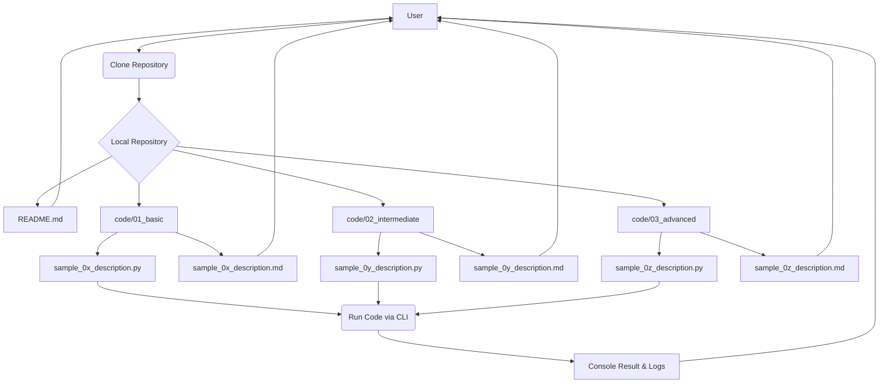

# Engineering Guidelines: Learn Python by Examples

## Technical Architecture

### 1. System Topology & Directory Structure
The repository is designed as a file-based educational system optimized for static exploration, local CLI execution, and version control. It follows a predictable modular layout:

```text
learn-python-by-examples/
├── .github/
│   └── assets/                 # Repository README banner and author avatar
│       ├── avatar.png
│       └── banner.png
├── code/                       # Main educational source code repository
│   ├── 01_basic/               # Beginner-level scripts and twin documentation
│   │   ├── sample_01_hello_world.py
│   │   └── sample_01_hello_world.md
│   ├── 02_intermediate/        # Intermediate-level scripts (control flow, functions, OOP)
│   └── 03_advanced/            # Advanced scripts (algorithms, optimization, generators)
├── docs/                       # Public project documentation (blueprint & guidelines)
│   ├── 01_project_blueprint.md
│   └── 02_engineering_guidelines.md
├── CHANGELOG.md                # Historical release log (Keep a Changelog standard)
├── LICENSE                     # Project license (MIT)
└── README.md                   # Primary project entry point & usage overview
```

### 2. Main Components Breakdown
- **Root Metadata (`/`):** Contains general repository configuration, public documentation (`README.md`, `LICENSE`), and release history (`CHANGELOG.md`).
- **Project Documentation (`/docs`):** The public documentation guides (`01_project_blueprint.md` and `02_engineering_guidelines.md`) + root `CHANGELOG.md` maintaining project vision, architecture, and release history.
- **Categorized Code Levels (`/code/01_basic`, `/code/02_intermediate`, `/code/03_advanced`):** Isolated folders grouping code examples by pedagogical complexity.
- **Twin File Standard (Option A Mini-Manual):** Every script `sample_XX_description.py` has an exact twin `sample_XX_description.md` that links directly to the `.py` file and serves as a concise mini-manual (core concept, focused snippets walkthrough, verified console output, and key takeaways) without duplicating the entire script verbatim (see Section 8 below).

### 3. Conceptual Data Flow & User Navigation
Interaction is purely local and file-based. The diagram below illustrates how users clone, navigate, read documentation, and execute sample code:



### 4. Database & State Management
- **Database:** N/A. The project operates strictly as a static code and documentation repository.
- **State Management:** When specific examples require state persistence (e.g., file handling, JSON serialization, SQLite examples in intermediate/advanced tiers), operations are confined locally within temporary output files or standard library context managers.

---

## Tech Stack Justifications

### Core Technologies
- **Python (3.11+):** Primary language (aligned with active Python security/bugfix releases after Python 3.10 reached End-of-Life in October 2026). Chosen for its clean readability, high expressiveness, widespread adoption, and rich standard library (`sys`, `os`, `math`, `collections`, `logging`, `argparse`, `pathlib`).
- **Markdown:** Chosen for all project documentation due to its lightweight syntax, broad compatibility, native rendering on GitHub, and support for diagrams (Mermaid).
- **Git & GitHub:** Chosen as the industry-standard version control system and open collaboration platform for code hosting, issue tracking, and peer reviews.

### Development Tools & Formatters
- **Mermaid:** Used for rendering visual system topologies and navigation flowcharts directly in markdown.
- **Formatting, Linting & Tooling:** `Ruff` (`ruff check --fix .` followed by `ruff format .`, 88-character line length, Unix `LF` line endings) for Python, `Prettier` for Markdown, `uv` (`uvx` / `uv run`) for isolated tool execution, and `mypy --strict` / `pyright` for static type checking on advanced samples.
- **Testing:** `pytest` / standard `unittest` used for testing complex functions and algorithmic samples.

### Evaluated & Excluded Technologies
- **Jupyter Notebooks:** Excluded to preserve raw `.py` script portability, straightforward CLI execution, and clean git diffs without bloated JSON metadata.
- **Heavyweight Frameworks (Django, Flask, FastAPI):** Excluded from the core curriculum to maintain absolute focus on language fundamentals without framework abstraction overhead.
- **Proprietary Documentation Tools:** Excluded in favor of standard markdown stored directly in version control.

---

## Development & Environment Setup

### 1. Prerequisites
- **Python 3.11+** installed (`python3 --version` or `python --version`).
- **Git** installed (`git --version`).

### 2. Local Setup & Execution Workflow
```bash
# 1. Clone the repository
git clone https://github.com/seyerjo/learn-python-by-examples.git

# 2. Enter the project root
cd learn-python-by-examples

# 3. Navigate to the desired level directory
cd code/01_basic

# 4. Execute an example script
python3 sample_01_hello_world.py
```

### 3. Branching & Git Workflow
- **Branch Isolation:** Every new feature, sample addition, or structural refactoring must be developed on a dedicated branch (e.g., `feature/<name>`, `refactor/<name>`, `chore/<name>`).
- **Conventional Commits:** All commit messages must follow standard Conventional Commits formatting (`feat(...)`, `fix(...)`, `docs(...)`, `refactor(...)`, `test(...)`, `chore(...)`) with imperative lower-case summaries under 72 characters.

---

## Code Style & Engineering Standards

### 1. Core Principles (PEP 8 & Clean Code)
- **Indentation & Spacing:** Exactly 4 spaces per indentation level. Never use tabs.
- **Line Length:** Maximum 88 characters for code (`Ruff` format standard); keep comments and docstrings concise and readable.
- **Line Endings & Clean Headers:** Use Unix `LF` line endings across all `.py` and `.md` files. Do not add obsolete `# MAIN CODE` headers or noisy ASCII comment boxes.
- **Blank Lines:** 2 blank lines before top-level functions and classes; 1 blank line before class methods.
- **Modularity (DRY):** Break complex operations into clean, reusable, single-responsibility functions. Avoid code duplication.

### 2. Naming Conventions
- **Functions, Variables & Modules:** `snake_case` (e.g., `calculate_fibonacci`, `total_count`, `sample_01_hello_world.py`).
- **Classes:** `PascalCase` (e.g., `BinarySearchTree`, `UserProfile`).
- **Constants:** `UPPER_SNAKE_CASE` (e.g., `MAX_RETRIES`, `DEFAULT_TIMEOUT`).

### 3. Type Hinting (PEP 484 / 585 / 604)
Type hints using modern Python syntax (`list[...]`, `dict[...]`, `int | None`, `collections.abc.Sequence`) are mandatory in `03_advanced` and production scripts—validated statically with `mypy --strict` or `pyright`—while intentionally deferred in `01_basic` and introductory `02_intermediate` samples to avoid beginner syntax noise (with brief forward-reference notes pointing to `sample_23_type_hinting.py`):
```python
def find_maximum(numbers: list[int | float]) -> int | float:
    """Finds the maximum value in a numeric list."""
    if not numbers:
        raise ValueError("Cannot find maximum of an empty list.")
    return max(numbers)
```

### 4. Docstring Standards (Google Python Style & PEP 257)
Every module, class, and public function must include a concise Google-style docstring (`Args:`, `Returns:`, `Yields:`, `Raises:` as applicable). **Do not repeat types inside `Args:`/`Returns:` when PEP 484 type annotations are already present on the signature** (per the Google Python Style Guide):
```python
def binary_search(elements: list[int], target: int) -> int:
    """Performs an iterative binary search on a sorted integer list.

    Args:
        elements: A sorted list of integers to search.
        target: The integer value to locate.

    Returns:
        The 0-based index of target if found, otherwise -1.

    Raises:
        ValueError: If elements is empty.
    """
    # ... implementation ...
```

### 5. Console Output & Stream Management
- **Data Payload:** Route primary data output intended for user consumption to `sys.stdout` (or standard `print()`).
- **Logs, Prompts & Errors:** Route telemetry, progress indicators, interactive prompts, and operational error messages to `sys.stderr` or Python's native `logging` module.
- **Testable Exit Codes:** Design `main() -> int` to return explicit integer status codes (`0` on success, distinct non-zero codes such as `1` on operational errors, `2` on CLI usage errors, `130` on `KeyboardInterrupt`/`SIGINT`) and invoke `raise SystemExit(main())` only inside `if __name__ == "__main__":`.
- **Event Logging:** For logging-enabled scripts, use module-scoped loggers (`logger = logging.getLogger(__name__)`) with lazy `%s` formatting (`logger.info("Processed %d items", count)`), streaming to `sys.stderr` by default and keeping file logging (`--log-file`) strictly opt-in.

### 6. Defensive Programming & Security Standards
- **Input Validation:** Always sanitize and validate user input (`input()`, CLI arguments) before processing.
- **Specific Exception Handling:** Wrap risky I/O, parsing, or conversion logic in `try-except` blocks catching specific exceptions (`ValueError`, `FileNotFoundError`, `ZeroDivisionError`). Never use bare `except:`.
- **Graceful Interrupts:** In advanced interactive or CLI scripts, catch `KeyboardInterrupt` (`SIGINT`) cleanly and exit with status `130` instead of printing a raw traceback.
- **Modern File I/O:** Use `pathlib.Path` over legacy `os.path` and always pass `encoding="utf-8"` explicitly on text file operations.
- **Subprocess Security:** When executing external system commands, always use `subprocess.run(["cmd", "arg1"], shell=False, check=True, timeout=...)`. Never pass raw string chains with `shell=True`.
- **Credential Protection:** Never hardcode secrets or pass them via CLI flags. Retrieve dynamic parameters via `os.getenv()` or gitignored `.env` files (documented with `.env.example`).

### 7. Pedagogical Progression Boundary (Rules by Difficulty Tier)
Because this repository is designed as a progressive learning path rather than a single production service, engineering practices are introduced incrementally across difficulty tiers—preserving clarity for beginners while building up to full production Python standards in advanced examples:

| Tier | Mandatory From Day One | Intentionally Deferred (Use Forward-Reference Notes) |
| :--- | :--- | :--- |
| **Basic (`code/01_basic`, `sample_00`–`09`+)** | `Ruff` lint & format (88 chars, `LF`), `snake_case` naming, modular `main()` + `if __name__ == "__main__":`, concise docstrings, concise non-redundant `.py` comments, Option A Mini-Manual `.md` | PEP 484 type hints, `try-except`, shebang (`#!/usr/bin/env python3`), `main() -> int` / `SystemExit`, `KeyboardInterrupt` (`130`), `sys.stderr`, `logging`, `argparse` |
| **Intermediate (`code/02_intermediate`, `sample_10`–`18`+)** | Everything in Basic + specific `try-except-else-finally` validation for interactive/I/O errors, Google-style `Args:`/`Returns:` docstrings on parameterized functions, `pathlib.Path` (`encoding="utf-8"`) for file I/O | PEP 484 type hints (introduced gently via forward-reference notes toward `sample_23`), shebang, `main() -> int` / `SystemExit`, `KeyboardInterrupt` (`130`), `sys.stderr`, `argparse`, `logging` |
| **Advanced & CLI (`code/03_advanced`, `sample_19`–`23`+)** | Everything in Intermediate + mandatory PEP 585/604 type hints (`mypy --strict`), Google docstrings **without** repeated PEP 484 types, shebang (`#!/usr/bin/env python3`), `main() -> int` + `raise SystemExit(main())`, graceful `KeyboardInterrupt` (`130`), `sys.stderr` error routing; plus `argparse`, `logging` (lazy `%s`, `stderr` default, opt-in file), `NO_COLOR`, and `.env` / `os.getenv()` in dedicated CLI/API samples | — (Full production console standards apply) |

### 8. Twin `.py` / `.md` Authoring Standard (All Current & Future Samples)
To ensure every baseline (`sample_00`–`sample_23`) and future expansion (`sample_24`–`sample_65`+) pair feels like one cohesive mini-manual with zero duplication or drift:

#### Python Script (`.py`) Rules
- **Clean File Top:** Omit obsolete `# MAIN CODE` banners and multi-line ASCII note boxes. In `03_advanced`, start with `#!/usr/bin/env python3`, followed immediately by a concise module docstring.
- **Concise Comment Policy:** Comments inside `.py` files must be brief and purposeful—explaining *why*, non-obvious intent, or subtle edge cases. Never narrate obvious Python syntax (`# Print the result`) and never duplicate textbook paragraphs that belong in the twin `.md` guide.
- **Direct Execution:** Every sample must run cleanly out of the box via `python3 code/<tier>/sample_XX_topic.py` and use Unix `LF` line endings.

#### Markdown Mini-Manual (`.md`) Template (Option A: Link + Focused Snippets)
Every `.md` twin links directly to its sibling `.py` file and walks the learner from concept to conclusion using short, focused snippets—never pasting the entire `.py` file verbatim:

```markdown
# <Descriptive Title>

<1–2 sentence overview of what the learner will master.>

**Source code:** [`sample_XX_topic.py`](./sample_XX_topic.py) · **Level:** Basic | Intermediate | Advanced

## Core Concept

<Explain the underlying Python concept and why it matters before diving into syntax.>

## Guided Walkthrough

<Step-by-step explanation referencing the sibling `.py` script using short, focused code snippets (typically 3–12 lines each). Never paste the entire `.py` file verbatim and never contradict or duplicate in-code comments.>

## Running the Example

```bash
python3 code/<tier>/sample_XX_topic.py
```

### Expected Output

```text
<Verified terminal output matching actual execution; include 2–3 brief scenarios for interactive or branching scripts.>
```

## Key Takeaways

- <3–5 crisp conclusions, common pitfalls to avoid, and an optional pointer to the next related sample.>
```
